<div align="center">

# DeCad
### The "Cursor for Hardware" · AI-Native Circuit IDE · Specctra DSN Routing Engine

[](https://www.kicad.org/)
[](https://www.docker.com/)
[](https://fastapi.tiangolo.com/)
[](https://nextjs.org/)
[](https://ngspice.sourceforge.io/)
[](https://en.wikipedia.org/wiki/SPECCTRA)
[](LICENSE)

<p align="center">
  <b>DeCad is "Cursor for Circuits" — an agentic, AI-first Integrated Development Environment for hardware engineering.</b><br/>
  Just as Cursor and modern developer tooling revolutionized software development through in-context pair programming and autonomous code synthesis, <b>DeCad brings agentic pair-engineering to physical electronics</b>: synthesizing native KiCad schematics, auto-routing via Specctra DSN, executing live electrical rules checks (ERC), running SPICE transient simulations, and sourcing exact components in real time.
</p>

<!-- Live Animated Experience Showcase -->
<p align="center">
  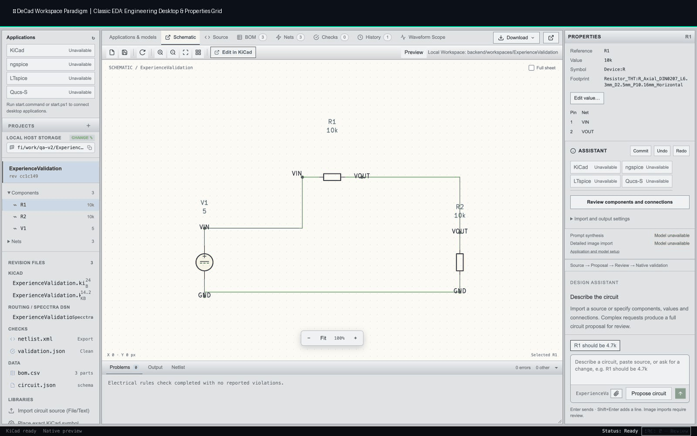
  <br/>
  <em>⚡ Dynamic Multi-Workspace Paradigm: Classic EDA · Studio IDE · Canvas · Review Desk · Simulation Lab</em>
</p>

---

</div>

## The Paradigm: "Cursor for Circuits"

For decades, software engineering evolved from raw terminal editors to intelligent IDEs with real-time linting, package management, and neural autocomplete. In contrast, **hardware engineers remained confined to manual, point-and-click graphical EDA suites from the 1990s**.

| Software Engineering (Cursor / Modern IDEs) | Hardware Engineering with **DeCad** |
| :--- | :--- |
| **Natural Language to Code**: Type intent, AI writes functions | **Natural Language to Schematic**: Type *"Add buck converter with 3.3V out"*, DeCad generates symbols & wiring |
| **Multimodal Inputs**: Screenshot a UI &rarr; React Component | **Multimodal Ingestion**: Photo of a whiteboard sketch &rarr; Native KiCad schematic |
| **Real-time Linting**: Red squiggles on syntax errors | **Real-time ERC**: Live KiCad Electrical Rules Check flags floating pins & shorted rails |
| **Package Managers**: `npm install` or `pip install` | **Automated Component Sourcing**: Auto-maps exact LCSC/JLCPCB part numbers, INR pricing & stock |
| **Compilers & Build Tools**: Webpack, GCC, Vite | **Native EDA Compilers**: KiCad S-Expression synthesis + Specctra DSN autorouter output |
| **Git Version Control**: Clean diffs and GitHub synchronization | **EDA Git Sync**: Semantic commit histories, S-expression diffing, and repo sync |

---

## Architectural Overview

Traditional circuit engineering suffers from severe fragmentation: schematic capture, netlist generation, simulation, routing, and component procurement occur in disparate, incompatible tools. **DeCad solves this by providing a unified pipeline from initial multimodal concept to DRC-clean PCB fabrication files.**

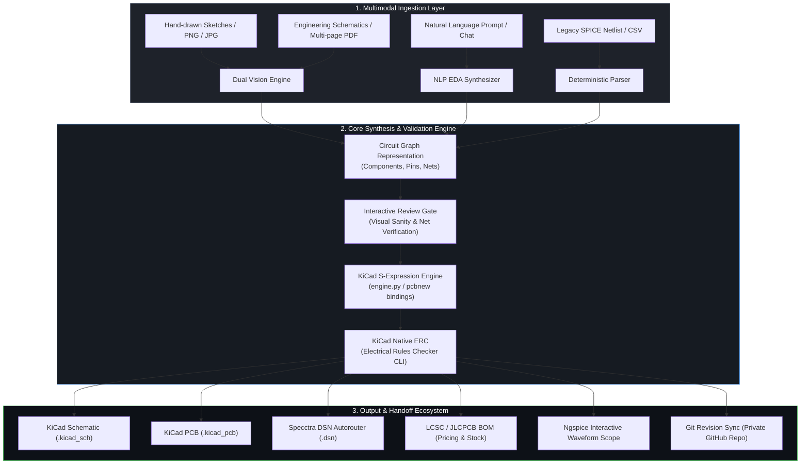

---
## 🎨 Five Distinct Engineering Workspaces (Zero Cookie-Cutter Layouts)

Unlike standard software tools that simply toggle CSS color variables, **DeCad re-architects the layout, tool rails, diagnostics docks, and interaction models for each engineering phase**:

<table>
  <tr>
    <td width="50%">
      <h3 align="center">1. Classic EDA (Engineering Desktop)</h3>
      <a href="evidence/experiences/experience-classic.png">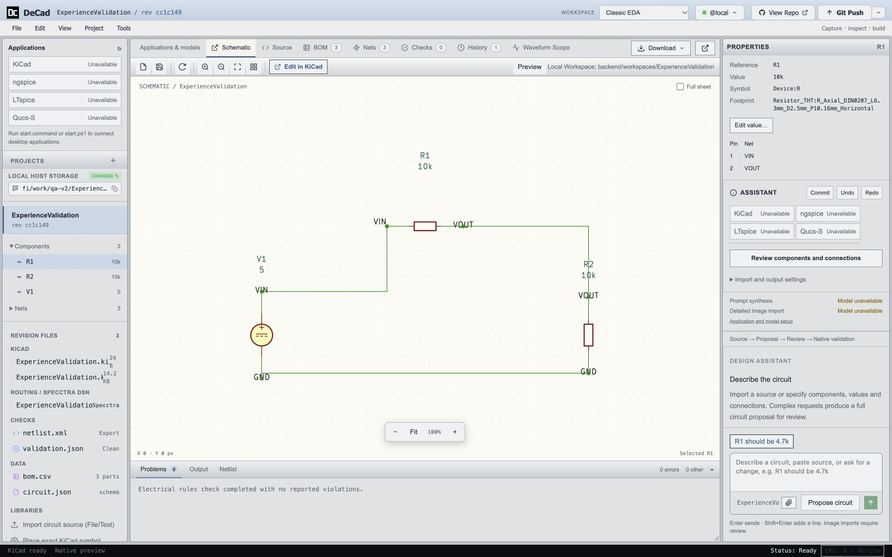</a>
      <p><b>Focus:</b> Capture &middot; Inspect &middot; Build</p>
      <ul>
        <li>Authentic light engineering aesthetic modeled after Cadence OrCAD / Altium Designer.</li>
        <li>Dual-tier command ribbons with persistent physical pin property inspector.</li>
        <li>Split-pane build output, console netlist explorer, and quick prompt execution dock.</li>
      </ul>
    </td>
    <td width="50%">
      <h3 align="center">2. Studio IDE (Developer Dark Flow)</h3>
      <a href="evidence/experiences/experience-ide.png">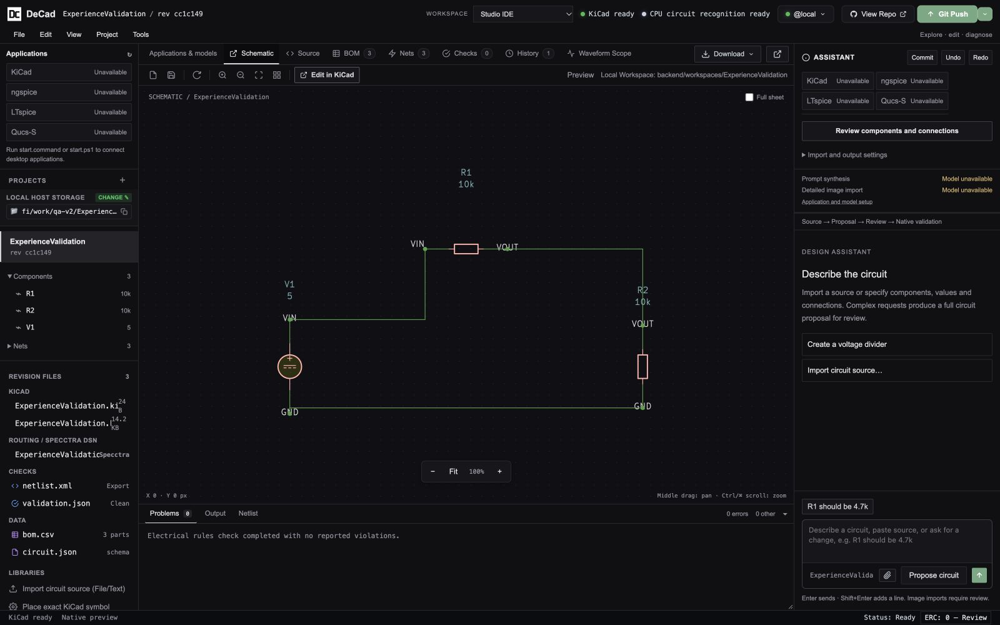</a>
      <p><b>Focus:</b> Explore &middot; Edit &middot; Diagnose</p>
      <ul>
        <li>Full dark document workspace with project hierarchy explorer and breadcrumbs.</li>
        <li>Dockable real-time diagnostic problems panel with ERC violation tracking.</li>
        <li>Direct integration with AI prompt engineering sidebar and automated model routing.</li>
      </ul>
    </td>
  </tr>
  <tr>
    <td width="50%">
      <h3 align="center">3. Canvas (Distraction-Free Drafting)</h3>
      <a href="evidence/experiences/experience-canvas.png">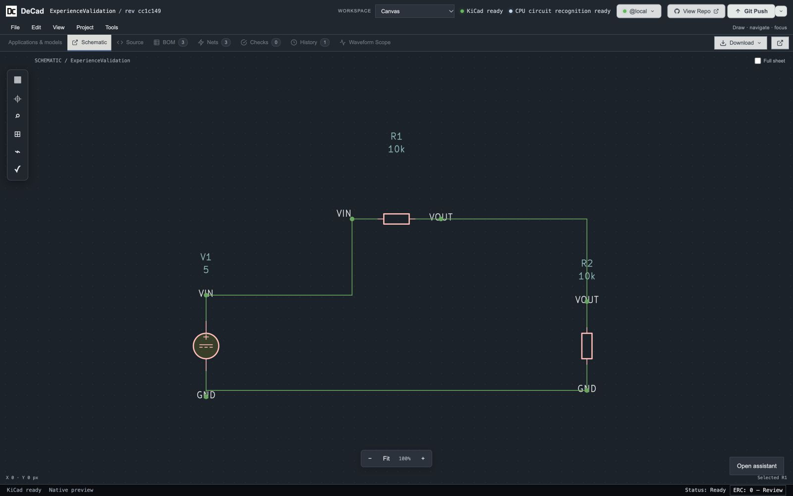</a>
      <p><b>Focus:</b> Draw &middot; Navigate &middot; Focus</p>
      <ul>
        <li>Maximized high-resolution vector canvas with radial grid backdrop.</li>
        <li>Floating vertical tool rail for instant placement, routing, and symbol selection.</li>
        <li>On-demand modal assistant drawer that minimizes automatically during deep CAD drafting.</li>
      </ul>
    </td>
    <td width="50%">
      <h3 align="center">4. Review Desk (Dual Verification Gate)</h3>
      <a href="evidence/experiences/experience-review.png">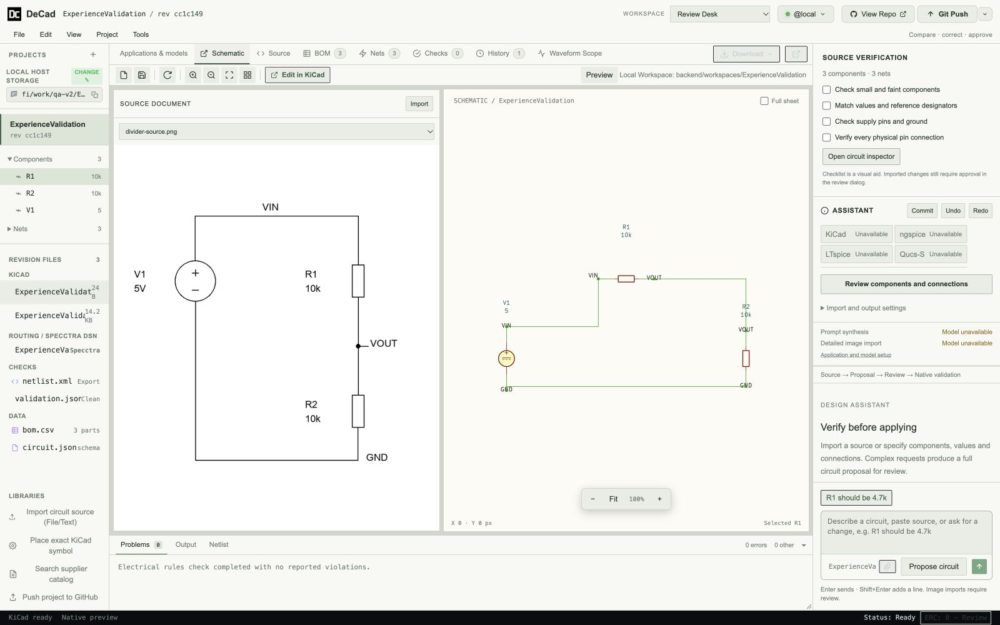</a>
      <p><b>Focus:</b> Compare &middot; Correct &middot; Approve</p>
      <ul>
        <li>Side-by-side synchronized comparison of original input (PDF/image) vs synthesized KiCad circuit.</li>
        <li>4-point verification checklist (faint parts, reference designators, rail polarity, pin connections).</li>
        <li>Zero-blind-commit guarantee: review net differences before committing to CAD.</li>
      </ul>
    </td>
  </tr>
  <tr>
    <td colspan="2">
      <h3 align="center">5. Simulation Lab (Hardware Testbench)</h3>
      <p align="center"><a href="evidence/experiences/experience-lab.png">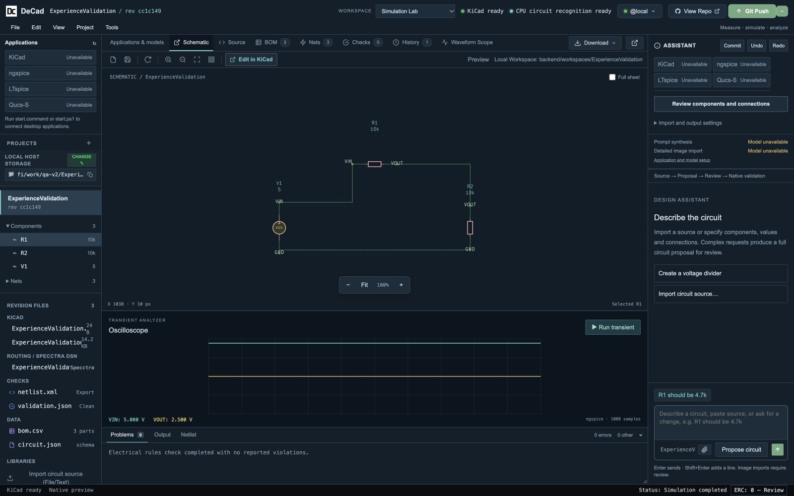</a></p>
      <p align="center"><b>Focus:</b> Measure &middot; Simulate &middot; Analyze</p>
      <ul>
        <li>Integrated interactive transient analyzer with embedded multi-channel digital oscilloscope.</li>
        <li>Live signal probe readings ($V_{\text{IN}}$, $V_{\text{OUT}}$) and real-time waveform acquisition.</li>
        <li>Seamless one-click dispatch to native external simulators (Ngspice, LTspice, Qucs-S).</li>
      </ul>
    </td>
  </tr>
</table>

---

## ⚡ Universal Application Mapping & File Dispatch

DeCad features an automated file association engine that inspects uploaded attachments or workspace files, automatically recommending the native EDA desktop application while allowing full engineer override:

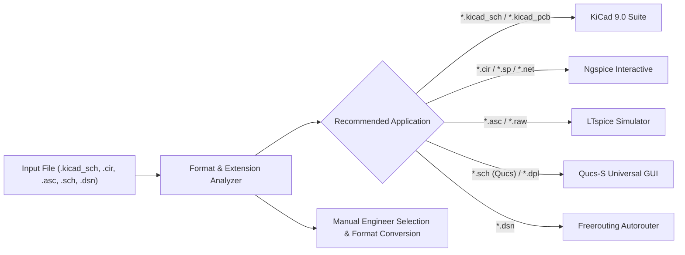

* **Direct Original Launch**: Launch the exact file in its dedicated native host application via the Desktop Bridge.
* **Intelligent Circuit Handoff**: Synthesize and translate current project schematics to any external tool on the fly.

---


---

## 🖼️ Screenshots

<table>
  <tr>
    <td width="50%">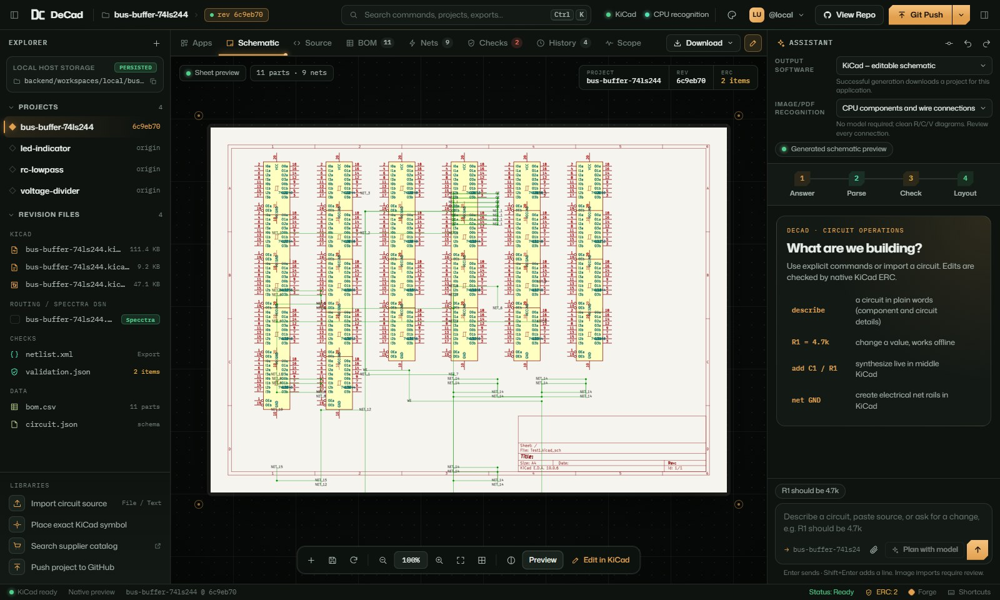<br><sub><b>Workbench</b> — explorer, live KiCad sheet with title block, assistant with the 4-stage pipeline.</sub></td>
    <td width="50%">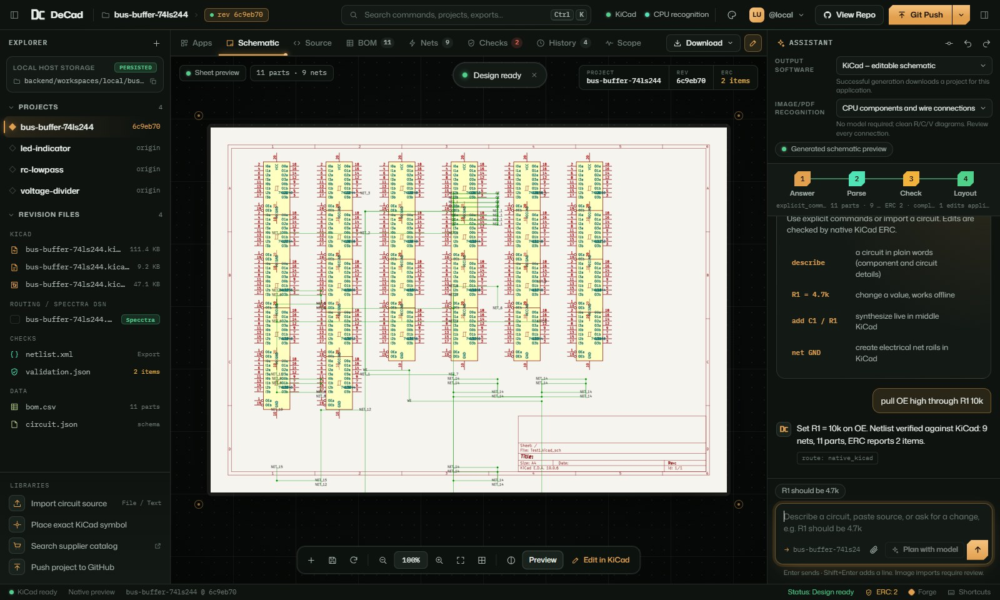<br><sub><b>Assistant</b> — a plain-English edit, verified against KiCad's netlist; every stage reports what it did.</sub></td>
  </tr>
  <tr>
    <td>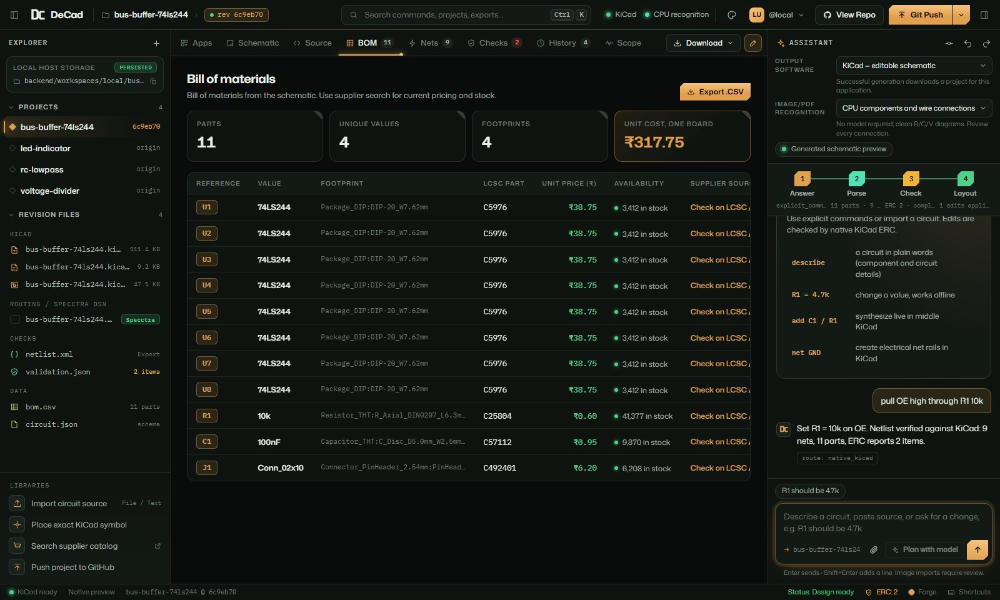<br><sub><b>BOM</b> — references, footprints, LCSC parts, indicative pricing, one-click supplier search.</sub></td>
    <td>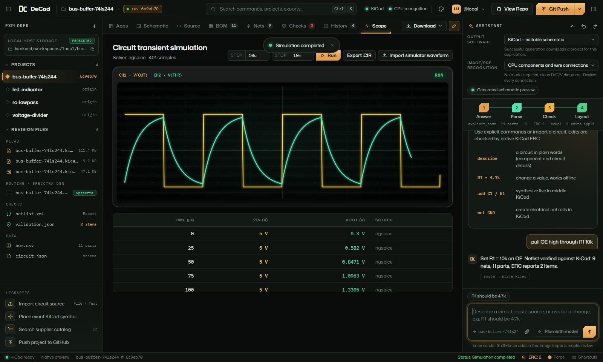<br><sub><b>Waveform Scope</b> — ngspice transient run on a phosphor oscilloscope.</sub></td>
  </tr>
  <tr>
    <td>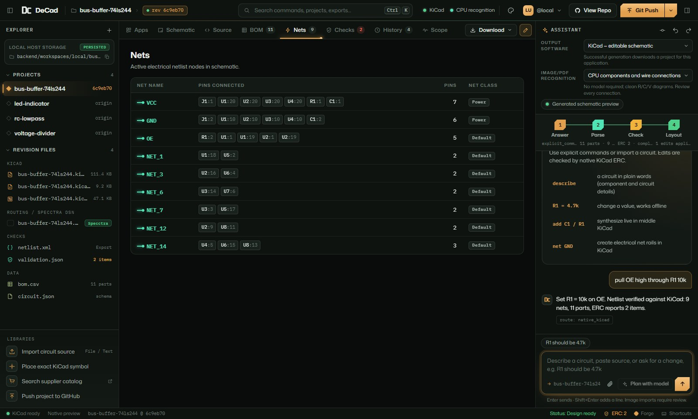<br><sub><b>Nets</b> — the actual pin connections from KiCad's XML netlist.</sub></td>
    <td>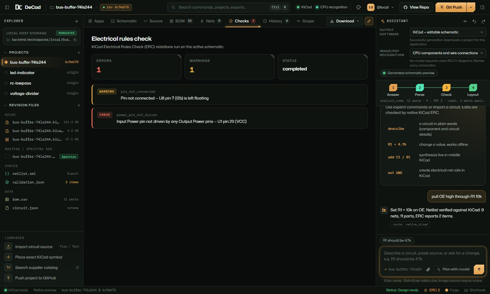<br><sub><b>Checks</b> — KiCad Electrical Rules Check, errors and warnings.</sub></td>
  </tr>
  <tr>
    <td>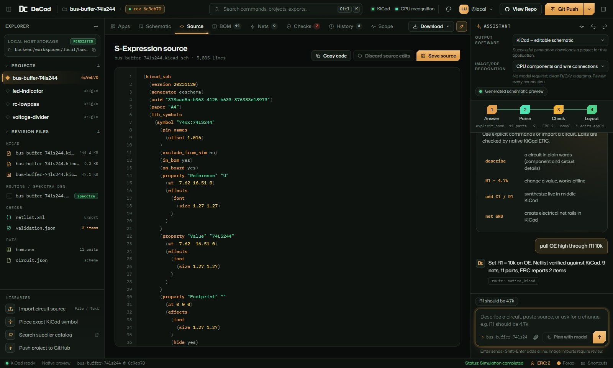<br><sub><b>Source</b> — edit the exact <code>.kicad_sch</code> S-expression, highlighted; KiCad re-parses on save.</sub></td>
    <td>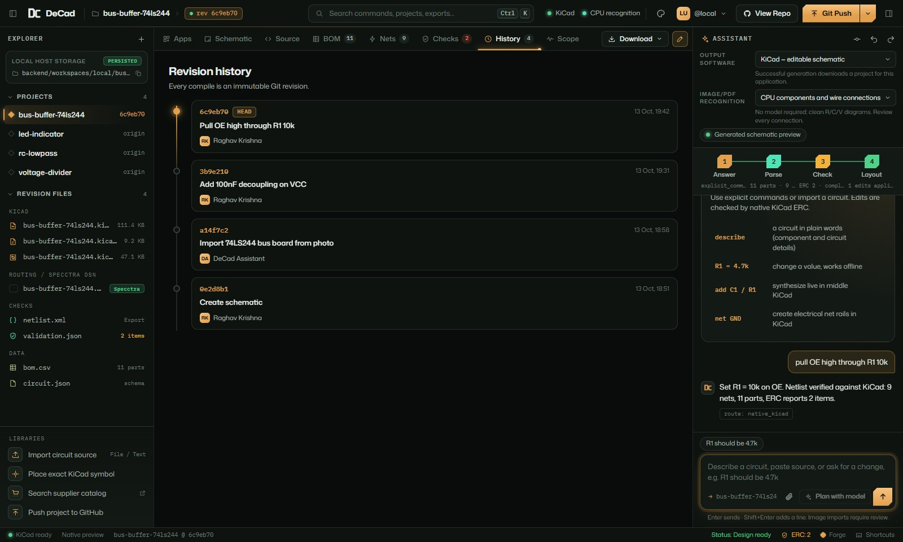<br><sub><b>History</b> — every change is a Git revision.</sub></td>
  </tr>
  <tr>
    <td>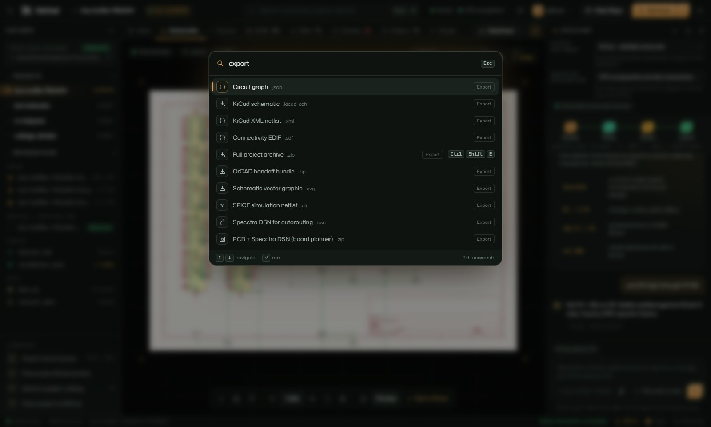<br><sub><b>Command palette</b> (<kbd>Ctrl</kbd> <kbd>K</kbd>) — every action, export, project and theme.</sub></td>
    <td>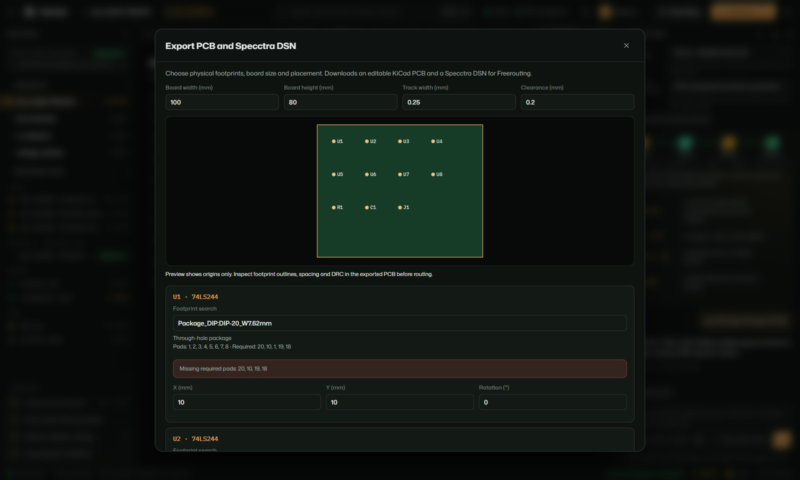<br><sub><b>PCB + Specctra DSN</b> — real footprints, pad checks, placement, routing rules.</sub></td>
  </tr>
  <tr>
    <td>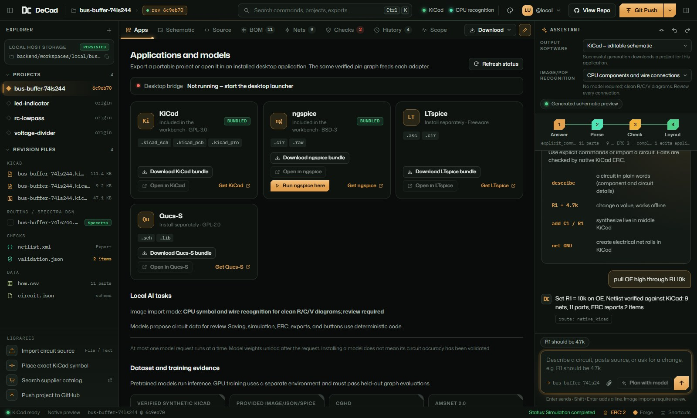<br><sub><b>Applications &amp; models</b> — KiCad, ngspice, LTspice and Qucs-S bundles; local model status.</sub></td>
    <td>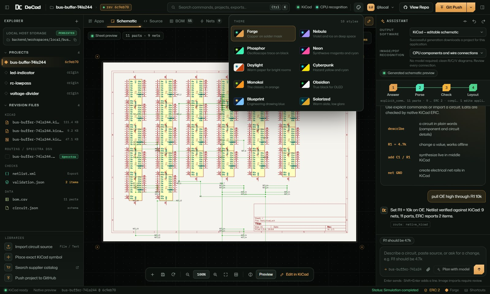<br><sub><b>10 themes</b>, switched with a circular reveal from the click.</sub></td>
  </tr>
</table>

<div align="center">
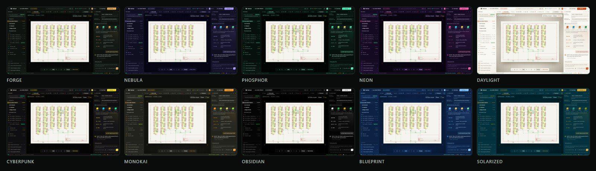
<sub>Forge · Nebula · Phosphor · Neon · Daylight · Cyberpunk · Monokai · Obsidian · Blueprint · Solarized</sub>
</div>

---


---

## 📚 Contents

- [The Paradigm: "Cursor for Circuits"](#the-paradigm-cursor-for-circuits)
- [Architectural Overview](#architectural-overview)
- [Five Distinct Engineering Workspaces](#-five-distinct-engineering-workspaces-zero-cookie-cutter-layouts)
- [Universal Application Mapping & File Dispatch](#-universal-application-mapping--file-dispatch)
- [Visual Screenshots & Interface Gallery](#%EF%B8%8F-screenshots)
- [Quick start (60 seconds)](#-quick-start-60-seconds)
- [Zero to complete guide](#-zero-to-complete-guide)
  - [1. Install the prerequisites](#1-install-the-prerequisites)
  - [2. Get the code](#2-get-the-code)
  - [3. Configure (optional)](#3-configure-optional)
  - [4. Launch](#4-launch)
  - [5. Sign in](#5-sign-in)
  - [6. Your first circuit](#6-your-first-circuit)
  - [7. Import a schematic photo, PDF or netlist](#7-import-a-schematic-photo-pdf-or-netlist)
  - [8. Review, edit and verify](#8-review-edit-and-verify)
  - [9. Simulate](#9-simulate)
  - [10. Export and make a PCB](#10-export-and-make-a-pcb)
  - [11. Commit and push to GitHub](#11-commit-and-push-to-github)
  - [12. Stop, update, uninstall](#12-stop-update-uninstall)
- [The workbench](#-the-workbench)
- [Keyboard shortcuts](#-keyboard-shortcuts)
- [Assistant command reference](#-assistant-command-reference)
- [Import formats](#-import-formats)
- [Export formats](#-export-formats)
- [PCB, Specctra DSN and Freerouting](#-pcb-specctra-dsn-and-freerouting)
- [Simulation](#-simulation)
- [Desktop applications and the bridge](#-desktop-applications-and-the-bridge)
- [GitHub integration](#-github-integration)
- [Local AI and the vision adapter](#-local-ai-and-the-vision-adapter)
- [Configuration reference](#-configuration-reference)
- [Architecture](#-architecture)
- [HTTP API reference](#-http-api-reference)
- [Development](#-development)
- [Testing and CI](#-testing-and-ci)
- [Troubleshooting & FAQ](#-troubleshooting--faq)
- [Security model](#-security-model)
- [Scope and limitations](#-scope-and-limitations)
- [Credits, third-party software and license](#-credits-third-party-software-and-license)

---


## 🚀 Quick start (60 seconds)

> **You need:** [Docker Desktop](https://www.docker.com/products/docker-desktop/) running (Compose v2.24+, ~4–6 GB RAM and 2 CPUs allocated) and [Git](https://git-scm.com/downloads).

```bash
git clone https://github.com/Mithunjagan/DeCad.git
cd DeCad
```

| OS | Start | Stop |
|---|---|---|
| **Windows** | `powershell -ExecutionPolicy Bypass -File .\start.ps1` | `powershell -File .\stop.ps1` |
| **macOS** | double-click `start.command` (or `./start.command`) | `./stop.command` |
| **Linux** | `./start.command` | `./stop.command` |

Then open **http://localhost:3100** → **Open Local Machine Workspace** → type `create a voltage divider` and press <kbd>Enter</kbd>.

> The first build downloads KiCad, ngspice and builds Qucs-S inside Docker — allow **10–20 minutes** and **~12 GB** of free disk. Later starts take seconds.

---

## 🧭 Zero to complete guide

This walks through everything, from an empty machine to a verified, simulated, routed, version-controlled circuit.

### 1. Install the prerequisites

**Required**

| Tool | Why | Get it |
|---|---|---|
| Docker Desktop (or Docker Engine + Compose v2.24+) | Runs KiCad 9, ngspice, Qucs-S, the API and the web app | https://www.docker.com/products/docker-desktop/ |
| Git | Clone the repo; every project is also a Git repo | https://git-scm.com/downloads |
| A modern browser | The workbench UI | Chrome, Edge, Firefox, Safari, Brave |

In **Docker Desktop → Settings → Resources**, give Docker **at least 4 GB RAM and 2 CPUs** (6 GB+ if you want the local language model; 7.5 GB+ for the local vision model). On Windows, use the WSL 2 backend.

**Optional**

| Tool | Unlocks |
|---|---|
| Python 3.11+ on the host | The desktop bridge that opens projects in your installed KiCad / LTspice / Qucs-S / ngspice |
| [KiCad 9 or 10](https://www.kicad.org/download/) on the host | Opening downloaded `.kicad_sch` / `.kicad_pcb` natively (KiCad already runs inside Docker) |
| [Freerouting](https://github.com/freerouting/freerouting) + Java 17+ | Autorouting the exported Specctra `.dsn` |
| [LTspice](https://www.analog.com/ltspice) | Opening LTspice bundles (not redistributed) |
| [Ollama](https://ollama.com) or a GPU machine / Google Colab | Local language model, or the trained vision adapter |
| A GitHub account | OAuth sign-in and one-click push |

### 2. Get the code

```bash
git clone https://github.com/Mithunjagan/DeCad.git
cd DeCad
```

**Component libraries (optional, recommended).** The Docker image already installs the official KiCad symbol and footprint libraries. To also mount the latest official libraries plus the DigiKey, SparkFun and Seeed community libraries and Qucs-S models into `libraries/`, run:

```bash
python tools/sync_libraries.py                 # everything
python tools/sync_libraries.py --targets kicad  # just official KiCad
```

The searchable component index (`libraries/index/components.db`) ships with the repo; rebuild it with `python tools/build_component_index.py` after syncing.

### 3. Configure (optional)

Everything works with zero configuration. To customise, create a `.env` file in the repo root (it is git-ignored):

```dotenv
# Image recognition: circuit (CPU, default) | ocr (labels only) | vision (model server)
IMAGE_MODE=circuit
# GitHub OAuth app (see "GitHub integration"); leave empty to use a Personal Access Token instead
GITHUB_CLIENT_ID=
GITHUB_CLIENT_SECRET=
# Show your real projects folder in the explorer's storage card
HOST_PROJECTS_DIR=
```

For backend-only settings, copy `backend/.env.example` to `backend/.env`. Every variable is listed in the [configuration reference](#-configuration-reference).

### 4. Launch

```bash
./start.command                                         # macOS / Linux
powershell -ExecutionPolicy Bypass -File .\start.ps1    # Windows
```

The launcher:

1. checks Docker is running and creates `backend/workspaces`, `backend/.state`, `backend/datasets`;
2. builds and starts the `kicad` (API + headless KiCad) and `frontend` containers;
3. starts the desktop bridge if Python is installed;
4. optionally starts local AI (see below) and opens **http://localhost:3100**.

Prefer plain Compose?

```bash
docker compose up -d --build            # core: API + KiCad + web app
docker compose --profile vision up -d   # also start the local Ollama model server
```

Optional AI flags for the launcher:

```bash
ENABLE_AI=true ./start.command       # small local language model (qwen3:0.6b, 2 GiB cap)
ENABLE_VISION=true ./start.command   # + local vision model (qwen3-vl:2b-instruct, needs ≥ 7.5 GB Docker RAM)
```

```powershell
$env:ENABLE_AI='true'; .\start.ps1
```

| Service | URL |
|---|---|
| Workbench | http://localhost:3100 |
| API | http://localhost:8100 (health: `/health`) |
| Embedded KiCad (noVNC) | http://localhost:6180/embedded.html |
| Ollama (optional) | http://localhost:11434 |

### 5. Sign in

The login screen shows live engine status (KiCad, recognition mode, ngspice).

- **Open Local Machine Workspace** — no account needed. Projects live in `backend/workspaces/local/`. (Enabled when `ALLOW_LOCAL_LOGIN=true`, the default.)
- **Sign in with GitHub** — uses OAuth if you configured an OAuth app; otherwise it asks for a Personal Access Token with the `repo` scope, verified directly with GitHub.

On first entry the workbench plays a short boot check and opens your first project.

### 6. Your first circuit

1. Click **+** in the Explorer (or <kbd>Ctrl</kbd> <kbd>K</kbd> → *New circuit project*) and name it, e.g. `divider`.
2. In the **Assistant**, pick **Output software** (KiCad by default) and type:

   ```text
   create a voltage divider
   ```

3. Watch the pipeline: **Answer → Parse → Check → Layout**. DeCad creates V1 = 5 V, R1 = 10 k, R2 = 10 k with VIN / VOUT / GND connections, saves a native schematic, runs ERC, and shows the sheet sweeping in on the canvas.
4. Make a change: `R2 = 4.7k` → a new verified revision appears.
5. Open **Nets**, **Checks** and **BOM** to inspect the result, and **Waveform Scope** to see VOUT.

### 7. Import a schematic photo, PDF or netlist

- Click **Import circuit source** in the Explorer, the 📎 in the composer, or **drag files onto the canvas or the assistant**.
- Choose **Image/PDF recognition**: *CPU components and wire connections* (default, no model), *Labels only* (OCR), or *Vision* (requires a vision server).
- DeCad recognises components and connections and opens the **Circuit Review** dialog: the source image beside an editable table of components, symbols and pin-to-net connections. Fix anything, tick **"I checked…"** and **Apply reviewed circuit**.

Nothing recognised from an image is written to KiCad without that review.

### 8. Review, edit and verify

- **Schematic** — drag to pan, <kbd>Ctrl</kbd>+wheel to zoom, <kbd>F</kbd> to fit, paper ⇄ ink colours. **Edit in KiCad** opens the real KiCad editor in the same pane; **Preview** returns to the generated sheet.
- **Source** — edit the raw `.kicad_sch` with line numbers and highlighting. **Save source** asks KiCad to parse it; a failed parse rolls back.
- **Undo / Redo / Commit** live in the assistant header.

### 9. Simulate

Open **Waveform Scope**, set *Step* and *Stop* in SPICE units (e.g. `10u`, `10m`) and press **Run**. ngspice runs inside Docker; CH1/CH2 show the first and last driven nodes. Use **Import simulator waveform** for `.raw` / `.csv` from LTspice or any simulator, or **Export .CIR** to run elsewhere.

### 10. Export and make a PCB

- **Download** (tab bar) offers the formats for the current tab; the command palette lists every export.
- For a board: **Nets → Download → PCB autorouter Specctra DSN**. Pick an installed footprint for each part (pads are checked against the pins you use), set board size, track width, clearance and placement, tick the confirmation, and download a ZIP with `board.kicad_pcb`, `board.dsn` and a verification report.
- Route it in Freerouting, import the `.ses` back into KiCad, run DRC. See [PCB, Specctra DSN and Freerouting](#-pcb-specctra-dsn-and-freerouting).

### 11. Commit and push to GitHub

- **Commit** (assistant header) records the current files in the project's local Git repository — no account needed.
- **Git Push** (title bar) commits and pushes to `<your-login>/s2sdn-<project>`, creating that GitHub repository if it doesn't exist. **View Repo** opens it, pushing first if needed.

### 12. Stop, update, uninstall

```bash
./stop.command                 # or .\stop.ps1 — stops containers (projects are kept)
git pull && docker compose up -d --build   # update
docker compose down --rmi local -v         # remove containers, images and the model volume
```

Your projects stay in `backend/workspaces/` until you delete that folder.

---

## 🖥️ The workbench

```
┌ Title bar ─ logo · project / rev · ⌘K search · engine LEDs · theme · account · View Repo · Git Push ┐
├ Explorer ────────┬ Tabs: Apps · Schematic · Source · BOM · Nets · Checks · History · Scope ┬ Assistant ┤
│ storage card     │                                                                  │ settings   │
│ projects         │         canvas  /  table  /  editor  /  oscilloscope             │ pipeline   │
│ revision files   │                                                                  │ chat       │
│ libraries        │         floating dock: zoom · fit · grid · ink · Preview · KiCad │ composer   │
└ Status bar ─ KiCad · mode · project@rev · status · ERC count · theme · shortcuts ─────────────────┘
```

| Area | What it does |
|---|---|
| **Title bar** | Project and revision chip (amber dot = uncommitted changes), command search, KiCad / recognition status LEDs, theme picker, account menu (GitHub profile, switch/link account, log out), **View Repo**, **Git Push** with options. |
| **Explorer** | Host storage card (click to copy the folder path) · projects (click to select, double-click to open the schematic) · revision files: KiCad files open in Source, `<project>.dsn` downloads a Specctra file, `netlist.xml` → Nets, `validation.json` → Checks, `bom.csv` → BOM, `circuit.json` → Source · Libraries: import a circuit source, place an exact KiCad symbol, search LCSC, push to GitHub. Collapsible groups; resize by dragging the seam; <kbd>Ctrl</kbd> <kbd>B</kbd> hides it. |
| **Apps** | Desktop bridge status, KiCad / ngspice / LTspice / Qucs-S bundle downloads and "Open in…", run ngspice / Qucs-S in place, local model status and evaluations, dataset evidence and synthetic-pair generation. |
| **Schematic** | The generated KiCad sheet with fiducials and a title block, a reveal sweep on every new revision, drag-to-pan, zoom, paper/ink modes, a floating dock and drag-and-drop import — or the native KiCad editor. |
| **Source** | The exact `.kicad_sch`, line-numbered and syntax-highlighted, with Copy, Discard and Save (validated by KiCad). |
| **BOM** | Summary cards (parts, unique values, footprints, indicative one-board cost) and a table of references, values, footprints, LCSC parts, indicative price and stock, and supplier links. Export CSV / JSON. |
| **Nets** | Every net with its pins as chips and the net class. Export Specctra, OrCAD hand-off, EDIF, SPICE, KiCad XML or JSON. |
| **Checks** | KiCad ERC errors and warnings, or a clean-ERC confirmation. |
| **History** | Git timeline with hash, message, author and time. |
| **Scope** | ngspice / Qucs-S transient simulation on an oscilloscope, sample table, waveform import, `.cir` export. |
| **Assistant** | Output software and recognition mode, the four-stage pipeline (with per-stage results after each run), quick commands, chat with attachments (double-click an image to inspect it), proposals ("Open Circuit Inspector"), design downloads, **Plan with model**. |
| **Status bar** | KiCad state, editor mode, project@revision, live status, ERC count (click → Checks), theme, shortcuts. Status changes also appear as short notifications. |

### Themes

Forge (copper on solder mask, default) · Nebula · Phosphor · Neon · Daylight · Cyberpunk · Monokai · Obsidian · Blueprint · Solarized. Pick one from the 🎨 button, the status bar or <kbd>Ctrl</kbd> <kbd>K</kbd> → "Theme". The choice is remembered per browser. All motion respects the OS *reduce motion* setting.

---

## ⌨️ Keyboard shortcuts

| Keys | Action |
|---|---|
| <kbd>Ctrl</kbd>/<kbd>⌘</kbd> <kbd>K</kbd> | Command palette — commands, exports, projects, themes |
| <kbd>Enter</kbd> / <kbd>Shift</kbd> <kbd>Enter</kbd> | Send to assistant / new line |
| <kbd>Alt</kbd> <kbd>1</kbd>…<kbd>8</kbd> | Switch tabs (Apps, Schematic, Source, BOM, Nets, Checks, History, Scope) |
| <kbd>Ctrl</kbd> <kbd>B</kbd> | Toggle the Explorer |
| <kbd>Ctrl</kbd> <kbd>.</kbd> | Toggle the Assistant |
| <kbd>F</kbd> · <kbd>+</kbd> · <kbd>−</kbd> | Fit / zoom the sheet |
| <kbd>Ctrl</kbd> + wheel · drag | Zoom · pan the sheet |
| <kbd>Ctrl</kbd> <kbd>Shift</kbd> <kbd>E</kbd> | Export the full project `.zip` |
| <kbd>?</kbd> | Show all shortcuts |
| <kbd>Esc</kbd> | Close menus and dialogs |

---

## 💬 Assistant command reference

Commands are deterministic and work **offline**; free-form descriptions use the optional local model and always come back as a reviewable proposal.

| You type | What happens |
|---|---|
| `create a voltage divider` | V1 = 5 V, R1 = R2 = 10 k with VIN / VOUT / GND |
| `create RC lowpass` | RC low-pass template (use a new project if references clash) |
| `add R3 4.7k` · `add C1 100nF` | Add parts with values |
| `add U1 74xx:74LS244` | Add an exact KiCad symbol (`Library:Symbol`) |
| `change R3 to 22k` · `R3 = 10k` · `R1 should be 4.7k` | Change a value |
| `remove R3` | Remove a part and its pin endpoints |
| `connect net GND to C1 pin 2` | Put a pin on a named net |
| `connect R1 pin 2 to C1 pin 1` | Connect two pins |
| `run ERC` | Re-run KiCad's electrical rules check |
| `undo` · `redo` | Restore schematic snapshots |
| `describe …` | Plain-language request for the model (optional AI) |
| **Plan with model** | The local model chooses a template and values; native code builds the connectivity; you review the proposal |

Duplicate references and unknown pinouts are **rejected**, never silently substituted. If a request conflicts with an existing design, DeCad creates a separate project instead of overwriting it.

---

## 📥 Import formats

| Input | Extensions | Result |
|---|---|---|
| SPICE netlist | `.cir` `.spice` `.net` | R / C / L / V / I / D / Q devices, values, node names, `.model` lines. `.include` and arbitrary scripts are rejected. |
| Circuit JSON | `.json` | Components and nets exactly as typed (schema below). |
| Component lists | `.txt` `.csv` `.docx` `.pdf` (text) | Component values; connections must be given explicitly. |
| Images / scanned PDF | `.png` `.jpg` `.jpeg` `.webp` `.pdf` | CPU symbol + wire recognition (clean R/C/V), labels-only OCR, or the vision model → **review dialog**. |

```json
{
  "components": [{ "ref": "R1", "value": "10k", "library": "Device:R", "footprint": "Resistor_SMD:R_0805_2012Metric" }],
  "nets": [{ "name": "GND", "nodes": [{ "ref": "R1", "pin": "2" }] }]
}
```

Ready-made inputs live in [`examples/`](examples): `divider.cir`, `rc-step.cir`, `diode.cir`, `divider.json`, `divider.png`, `parts.csv`, `specctra-plan.json`.

Save legacy `.doc` files as `.docx`. Unreadable or unsupported inputs produce a visible error — never a fake "success".

---

## 📤 Export formats

| From | Format | Notes |
|---|---|---|
| Schematic | `.svg`, `.kicad_sch`, full project `.zip` | KiCad-exported vector sheet; complete project archive |
| Source | `.kicad_sch`, `.txt` | The exact S-expression |
| BOM | `.csv`, `.json` | Reference, value, footprint, LCSC part, price, stock |
| Nets | Specctra DSN `.zip`, OrCAD hand-off `.zip`, EDIF `.edf`, SPICE `.cir`, KiCad XML, JSON | EDIF keeps real port-to-instance connectivity |
| Explorer | `<project>.dsn` | Direct Specctra DSN via `pcbnew` |
| Checks · History | `.json` | ERC report · Git timeline |
| Apps | KiCad / ngspice / LTspice / Qucs-S bundles | Portable projects built from the same verified pin graph |
| Assistant | Design for the selected output software | Downloaded automatically after a successful generation |

---

## 🧩 PCB, Specctra DSN and Freerouting

Specctra `.dsn` is an **autorouter input** (not OrCAD Capture's schematic DSN). DeCad generates it through KiCad's native `pcbnew.ExportSpecctraDSN`.

1. **Nets → Download → PCB autorouter Specctra DSN** (or <kbd>Ctrl</kbd> <kbd>K</kbd> → "PCB + Specctra DSN").
2. For every component, search and pick an installed `Library:Footprint`. Missing pads for the pins you use are flagged and block export.
3. Enter board width/height, track width, clearance, and X / Y / rotation for each part. The preview shows footprint origins.
4. Confirm and download. The ZIP contains `board.dsn`, editable `board.kicad_pcb` + `board.kicad_pro`, the source circuit, the plan, a verification report and a SHA-256 manifest. The board is saved, reopened and its pad/net mapping compared with the source, and the DSN network entries are checked independently.
5. Route it (separate install), for example headless Freerouting 2.0.1:

```bash
java -Djava.awt.headless=true -Xmx512m -jar freerouting-2.0.1.jar \
  -de board.dsn -do board.ses -mp 5 -mt 1 -da --gui.enabled=false
```

6. Import `board.ses` into the same board in KiCad and run **DRC**.

API users can `POST /projects/{project}/export/specctra` with a plan like [`examples/specctra-plan.json`](examples/specctra-plan.json). More detail: [SPECCTRA.md](SPECCTRA.md).

> This export is not fabrication approval: placement and courtyard overlap, routing completion and DRC still need your review.

---

## 📈 Simulation

- **ngspice** (bundled in Docker) runs transient analysis from the schematic. Set step/stop with SPICE units (`1u`, `5m`); runs are limited to 20,000 time steps.
- **Qucs-S 26.1.1** (built in the image) runs from **Apps → Run Qucs-S here**.
- Native installs without ngspice can use the built-in linear R/C/L/V/I modified-nodal-analysis solver.
- **Import simulator waveform** accepts uncompressed `.raw` and `.csv` (time in seconds, up to 20,000 samples, ≤ 25 MB).
- Floating, unpowered or unsupported-model circuits fail visibly with an explanation.

---

## 🧰 Desktop applications and the bridge

**Apps** builds a portable bundle for each tool from the circuit's verified pin graph:

| App | Bundle | Runs in the workbench |
|---|---|---|
| KiCad | native schematic / project | ✅ (embedded editor) |
| ngspice | SPICE netlist | ✅ |
| Qucs-S | native schematic + SPICE subcircuit wrapper | ✅ |
| LTspice | SPICE netlist | — (install separately) |

**Open in …** uses the **desktop bridge** (`bridge/desktop_bridge.py`), started by the launcher when Python 3.11+ is available. It has no network listener and only opens registered application artifacts. Point it at non-standard installs with `S2SDN_KICAD_PATH`, `S2SDN_LTSPICE_PATH`, `S2SDN_QUCS_S_PATH`, `S2SDN_NGSPICE_PATH`. Bundles download fine without the bridge.

---

## 🐙 GitHub integration

**Option A — Personal Access Token (zero setup).** Click *Sign in with GitHub*. With no OAuth app configured you'll be asked for a token: [create one with the `repo` scope](https://github.com/settings/tokens/new?scopes=repo&description=DeCad), paste it, and DeCad verifies it with the GitHub API.

**Option B — OAuth app.**

1. GitHub → *Settings → Developer settings → OAuth Apps → New OAuth App*.
2. Homepage `http://localhost:3100`, callback **`http://localhost:8100/auth/callback`**.
3. Put the client ID/secret in `.env` (or `backend/.env`):
   ```dotenv
   GITHUB_CLIENT_ID=Iv1.xxxxxxxx
   GITHUB_CLIENT_SECRET=xxxxxxxxxxxxxxxx
   ```
4. `docker compose up -d kicad` to restart the API.

Pushing creates `<login>/s2sdn-<project>` if needed. OAuth state is verified; the browser cookie holds only a random session ID; tokens stay in the local session store and reach Git through a temporary askpass helper — never in remote URLs.

---

## 🧠 Local AI and the vision adapter

Everything core — editing, ERC, exports, simulation, CPU recognition — works **without any model**. Models only *propose* data; deterministic code validates and applies it after your review.

**Local language model (Ollama).** `ENABLE_AI=true` starts the `vision` Compose profile (Ollama) and pulls `qwen3:0.6b` under a 2 GiB cap (`MODEL_MEMORY_LIMIT`). One request at a time, 2,048-token context, weights unloaded afterwards. Point `OLLAMA_URL` at another server to use your own.

**Local vision model.** `ENABLE_VISION=true` (≥ 7.5 GB Docker RAM) selects `IMAGE_MODE=vision` and pulls `qwen3-vl:2b-instruct` with a 4 GiB cap.

**Trained Qwen2.5-VL LoRA adapter (GPU / Colab).** Weights are distributed separately (`*.safetensors` is git-ignored). To serve them:

1. Open [`training/Train_Schematic2SDN_Colab.ipynb`](training/Train_Schematic2SDN_Colab.ipynb) on a T4/A100 runtime and upload the adapter folder.
2. Start the Ollama-compatible server:
   ```bash
   S2SDN_ADAPTER=/content/checkpoints/circuit-lora/adapter \
   S2SDN_MODEL_TAG=schematic2sdn-qwen-vl \
   python -m uvicorn serve:app --app-dir training --host 0.0.0.0 --port 11435
   ```
3. Forward it locally: `ssh -N -L 11435:127.0.0.1:11435 user@gpu-host`.
4. In `.env`:
   ```dotenv
   IMAGE_MODE=vision
   VISION_MODEL=schematic2sdn-qwen-vl
   VISION_OLLAMA_URL=http://host.docker.internal:11435
   ```
5. `docker compose up -d kicad` — the title bar LED switches to the vision model.

**Training your own.** [`training/README.md`](training/README.md) covers paired-data preparation, audit and group-disjoint splits (`training/dataset_tools.py`), 4-bit LoRA fine-tuning (`training/finetune.py`), held-out evaluation (`training/evaluate.py`) and serving. Hardware notes: [`training/HARDWARE.md`](training/HARDWARE.md). Release criteria: [`RELEASE_GATES.md`](RELEASE_GATES.md).

---

## ⚙️ Configuration reference

Set these in the root `.env`, `backend/.env`, or your shell before launching.

| Variable | Default | Purpose |
|---|---|---|
| `IMAGE_MODE` | `circuit` | `circuit` (CPU symbols + wires), `ocr` (labels only), `vision` (model server) |
| `OLLAMA_URL` | `http://vision:11434` (Docker) | Language-model server |
| `CHAT_MODEL` | `qwen3:0.6b` | Model used by the assistant / **Plan with model** |
| `VISION_MODEL` | `qwen3-vl:2b-instruct` | Vision model name (`schematic2sdn-qwen-vl` for the adapter) |
| `VISION_OLLAMA_URL` | — | Separate vision server (falls back to `OLLAMA_URL`) |
| `MODEL_MEMORY_LIMIT` | `2g` | Memory cap of the Ollama container |
| `ENABLE_AI` / `ENABLE_VISION` | `false` | Launcher switches for the local models |
| `GITHUB_CLIENT_ID` / `GITHUB_CLIENT_SECRET` | — | GitHub OAuth app |
| `ALLOW_LOCAL_LOGIN` | `true` | Show **Open Local Machine Workspace** |
| `SESSION_SECRET` | generated | Cookie signing secret (persisted in `backend/.state` if empty) |
| `FRONTEND_URL` / `BACKEND_URL` | `http://localhost:3100` / `:8100` | OAuth redirects |
| `HOST_PROJECTS_DIR` | — | Host path shown in the explorer's storage card |
| `S2SDN_HOST_UID` / `S2SDN_HOST_GID` | `1000` | File ownership inside the container (set by the launcher on macOS/Linux) |
| `KICAD_CLI` / `KICAD_SYMBOL_DIR` / `KICAD_PYTHON` | auto | Native (non-Docker) KiCad paths |
| `S2SDN_KICAD_PATH` / `S2SDN_LTSPICE_PATH` / `S2SDN_QUCS_S_PATH` / `S2SDN_NGSPICE_PATH` | auto | Desktop bridge application paths |
| `S2SDN_ADAPTER` / `S2SDN_MODEL_TAG` | — | Vision adapter server (`training/serve.py`) |
| `INTERNAL_API_URL` | `http://localhost:8100` | Where the web app proxies `/api` (set to `http://kicad:8000` in Docker) |
| `NEXT_PUBLIC_API_URL` / `NEXT_PUBLIC_KICAD_URL` | `/api` / `http://localhost:6180/embedded.html` | Browser-side API and embedded-editor URLs |

**Ports** (all bound to `127.0.0.1`): `3100` web app · `8100` API · `6180` embedded KiCad · `11434` Ollama (optional).

**Data**

| Path | Contents |
|---|---|
| `backend/workspaces/<user>/<project>/` | Your projects — each a Git repository with KiCad files and `references/` attachments |
| `backend/.state/` | Sessions, jobs, bridge state |
| `backend/datasets/` | Synthetic and provided training pairs |
| `libraries/` | Synced KiCad / community libraries and `index/components.db` |

---

## 🏗️ Architecture

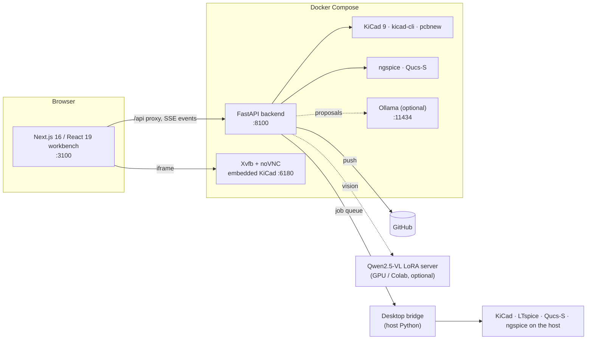

**How a request becomes a verified revision**

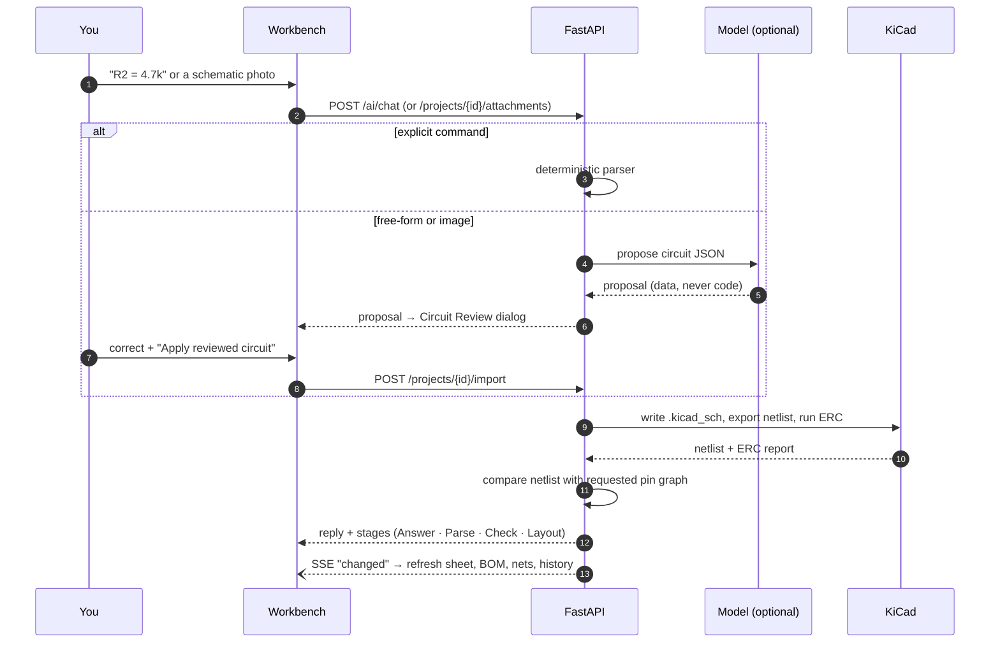

**Stack:** Next.js 16 · React 19 · FastAPI · Pydantic 2 · KiCad 9 (`kicad-cli`, `pcbnew`) · ngspice · Qucs-S · OpenCV · Tesseract · PyMuPDF · python-docx · NumPy/SciPy · Ollama · Qwen2.5-VL + PEFT LoRA · Docker Compose · noVNC. UI type: Mona Sans and IBM Plex Mono (bundled, SIL OFL 1.1).

<details>
<summary><b>Repository layout</b></summary>

```
DeCad/
├── backend/
│   ├── app/
│   │   ├── main.py               # API routes: auth, projects, exports, git, AI, events
│   │   ├── engine.py             # KiCad S-expression editing, placement, netlist, ERC
│   │   ├── assistant.py          # command parser + model routing + pipeline stages
│   │   ├── ingestion.py          # SPICE / JSON / text / PDF / DOCX / image import
│   │   ├── circuit_vision.py     # CPU R/C/V symbol + wire recognition
│   │   ├── vision_local.py       # vision-model client
│   │   ├── specctra.py           # Specctra DSN orchestration
│   │   ├── specctra_worker.py    # pcbnew worker (board + DSN export)
│   │   ├── simulation.py         # ngspice / MNA solver
│   │   ├── waveforms.py          # .raw / .csv waveform import
│   │   ├── integrations.py       # KiCad / ngspice / LTspice / Qucs-S bundles + bridge jobs
│   │   ├── formats.py            # EDIF, XML, SPICE writers
│   │   └── …
│   ├── tests/                    # pytest suite
│   └── requirements*.txt
├── frontend/
│   ├── app/
│   │   ├── page.js               # the workbench + login
│   │   ├── globals.css           # design system + 10 themes
│   │   ├── ui/                   # icons, logo, hero animation, command palette, themes
│   │   ├── CircuitReview.js      # review dialog for recognised circuits
│   │   ├── BoardExport.js        # PCB + Specctra planner
│   │   └── IntegrationsPanel.js  # applications & models
│   ├── public/fonts/             # Mona Sans, IBM Plex Mono (OFL)
│   └── tests/
├── bridge/desktop_bridge.py      # opens bundles in host applications
├── docker/kicad/                 # KiCad + ngspice + Qucs-S + noVNC image
├── training/                     # dataset tools, LoRA fine-tune, evaluation, adapter server, Colab
├── tools/                        # library sync, component index, release checks
├── libraries/index/components.db # searchable component index
├── examples/                     # sample circuits, Specctra plan and routed fixture
├── docs/                         # banner and screenshots
├── docker-compose.yml
├── start.ps1 · start.command · stop.ps1 · stop.command
└── README.md
```
</details>

---

## 🔗 HTTP API reference

The browser talks to these through the same-origin `/api` proxy; all project routes require a session (local login or GitHub). Base URL: `http://localhost:8100`.

<details>
<summary><b>Show all endpoints</b></summary>

| Method | Path | Purpose |
|---|---|---|
| GET | `/health` | KiCad / symbols / ngspice / embedded / image-mode status |
| GET | `/vision/status` | Recognition mode and model readiness |
| GET | `/auth/config` · `/auth/me` | Login options · current user |
| GET | `/auth/dev` | Local workspace login (when allowed) |
| GET | `/auth/login` · `/auth/callback` | GitHub OAuth |
| POST | `/auth/github-token` · `/auth/logout` | PAT login · log out |
| GET / POST | `/projects` | List / create projects |
| GET | `/projects/{pid}/details` | Components, nets, ERC, revisions, files |
| GET | `/projects/{pid}/files` · `/file?name=` | List / read files |
| PUT | `/projects/{pid}/file?name=` | Save source (KiCad-validated, hash-checked) |
| GET | `/projects/{pid}/preview.svg` · `/graph` · `/netlist` · `/validate` | Sheet SVG · circuit graph · XML netlist · ERC |
| GET | `/projects/{pid}/export/{project-zip,spice,edif,orcad-bundle,orcad-tcl,specctra-dsn}` | Exports |
| POST | `/projects/{pid}/export/specctra` | PCB plan → board + DSN ZIP |
| GET | `/projects/{pid}/simulate` · `/integrations/qucs-s/simulate` | Transient simulation |
| POST | `/projects/{pid}/waveforms/import?name=` | Import `.raw` / `.csv` |
| POST | `/projects/{pid}/attachments?name=` | Upload a reference file |
| POST | `/projects/{pid}/import` | Apply a reviewed circuit |
| POST | `/ai/chat` · `/ai/plan` | Assistant request · model plan |
| GET | `/projects/{pid}/vision/analyze` | Recognise an attachment |
| POST | `/projects/{pid}/control?action=` | `undo`, `redo`, `zoom_*`, `redraw`, … |
| POST | `/projects/{pid}/activate` · `/open-native` | Embedded KiCad session |
| GET | `/projects/{pid}/events` | Server-sent events (`changed`) |
| GET | `/projects/{pid}/git/status` | Git state |
| POST | `/projects/{pid}/git/commit` · `/git/push` | Commit · push to GitHub |
| GET | `/integrations` · `/integrations/jobs/{jid}` | Applications · bridge job status |
| GET / POST | `/projects/{pid}/integrations/{tool}/bundle` · `/open` | Download bundle · open on host |
| GET | `/libraries/symbols` · `/libraries/footprints` · `/libraries/footprint` | Library search |
| GET | `/models/status` · `/datasets/summary` | Model and dataset status |
| POST | `/datasets/synthetic/generate?count=` | Generate verified image/netlist pairs |

</details>

```bash
curl http://localhost:8100/health
```

---

## 🛠️ Development

Run the services natively for fast iteration (Python 3.12+, KiCad CLI 9+, Node 22+):

```bash
# backend
cd backend
python3 -m venv .venv
.venv/bin/pip install -r requirements-dev.txt          # Windows: .venv\Scripts\pip
.venv/bin/uvicorn app.main:app --host 127.0.0.1 --port 8100

# frontend (another terminal)
cd frontend
npm ci
npm run dev        # http://localhost:3100, proxies /api → localhost:8100
```

On macOS the installed KiCad is detected automatically; elsewhere set `KICAD_CLI` and `KICAD_SYMBOL_DIR`. Set `OLLAMA_URL=http://localhost:11434` to use a host Ollama.

Rebuild only the UI container after frontend changes: `docker compose up -d --build frontend`.

---

## ✅ Testing and CI

```bash
# backend (needs KiCad CLI + symbol libraries)
cd backend && .venv/bin/python -m pytest tests -q

# frontend review/board-plan logic
cd frontend && node --test tests/review-model.test.mjs

# release blockers
python tools/check_release.py --output release-status.json
```

GitHub Actions ([`validation.yml`](.github/workflows/validation.yml)) runs the desktop-bridge tests on macOS, Windows and Ubuntu, parses the PowerShell launchers, builds both containers and runs the full backend suite inside the KiCad image. Recorded acceptance evidence lives in [`evidence/`](evidence), [`VERIFICATION.md`](VERIFICATION.md) and [`RELEASE_GATES.md`](RELEASE_GATES.md).

---

## 🩺 Troubleshooting & FAQ

<details>
<summary><b>"Start Docker Desktop first" / the launcher exits immediately</b></summary>

Open Docker Desktop and wait until it reports *Running*, then rerun the launcher. On Windows make sure the WSL 2 backend is enabled.
</details>

<details>
<summary><b>The first build is slow</b></summary>

It downloads Debian KiCad packages and compiles Qucs-S from source once. Later builds use the Docker cache. Keep ~12 GB free.
</details>

<details>
<summary><b>Port 3100 / 8100 / 6180 is already in use</b></summary>

Stop the other program or change the left side of the port mapping in `docker-compose.yml` (e.g. `"127.0.0.1:3200:3000"`).
</details>

<details>
<summary><b>The status LED says "KiCad unavailable"</b></summary>

`docker compose ps` — the `kicad` service must be *healthy*. Check `docker compose logs kicad`. For native runs, set `KICAD_CLI` to your `kicad-cli`.
</details>

<details>
<summary><b>"Open Local Machine Workspace" is disabled</b></summary>

Set `ALLOW_LOCAL_LOGIN=true` (the default) in `backend/.env` and restart: `docker compose up -d kicad`.
</details>

<details>
<summary><b>Git Push says "Sign in with GitHub to push"</b></summary>

Local sessions can commit but not push. Use *account menu → Link GitHub account* and paste a PAT with the `repo` scope, or configure an OAuth app.
</details>

<details>
<summary><b>An image import found nothing / wrong wires</b></summary>

CPU recognition handles clean resistor, capacitor and voltage-source drawings. Crop to the circuit, use a sharp, straight photo, or switch to *Vision* with a configured model. Every result is editable in the review dialog.
</details>

<details>
<summary><b>The simulation fails</b></summary>

The circuit needs a source and a ground reference; floating nodes and unsupported models are reported, not guessed. Check *Step* / *Stop* units (`10u`, `10m`).
</details>

<details>
<summary><b>The embedded KiCad editor is blank or frozen</b></summary>

Close any open KiCad dialog (automated edits wait for it), click **Preview** then **Edit in KiCad** again, or open http://localhost:6180/embedded.html directly. The embedded desktop is shared and meant for one local user at a time.
</details>

<details>
<summary><b>Where are my files?</b></summary>

`backend/workspaces/<user>/<project>/` — click the storage card in the Explorer to copy the exact path. Stopping or rebuilding containers never deletes it.
</details>

---

## 🔐 Security model

- All services bind to **127.0.0.1**. Do not expose them publicly without a proper deployment and authentication layer.
- Model output is treated as **data**: validated against the circuit schema, installed symbol pins and requested references before it reaches KiCad.
- Sessions are server-side; the cookie holds only a random ID. OAuth `state` is verified.
- GitHub tokens never appear in repository URLs; Git receives them through a temporary askpass helper.
- `.env`, sessions, workspaces, datasets and model weights are git-ignored.
- The desktop bridge has no network listener and only launches registered artifacts.

---

## 📏 Scope and limitations

Being honest about what is and isn't verified:

- CPU image recognition is a bounded R/C/V recogniser, not general schematic recognition. The general vision path is opt-in and its circuit accuracy has not passed a published benchmark — always review.
- ERC checks electrical rules; it cannot prove a recognised diagram matches its source image.
- BOM prices and stock are **indicative** values tied to each LCSC part number; confirm live pricing and availability on LCSC / JLCPCB before ordering.
- Native OrCAD `.DSN` (schematic) is not produced; an OrCAD hand-off bundle and EDIF are.
- Specctra export makes a rectangular two-layer board; arbitrary outlines, multilayer stack-ups and automatic placement are out of scope. It is not fabrication approval.
- The embedded KiCad desktop is single-user.

---

---

## 🙌 Credits, Third-Party Software and License

Developed by **Raghav Krishna ([@JRK14](https://github.com/JRK14))** and **[@Mithunjagan](https://github.com/Mithunjagan)**.

DeCad stands on excellent open source engineering:
- **[KiCad](https://www.kicad.org)** (GPL-3.0+) &mdash; Native schematic capture, S-expression engine, and `pcbnew` Python bindings
- **[Ngspice](https://ngspice.sourceforge.io)** (BSD) &mdash; Interactive transient simulation engine
- **[Qucs-S](https://github.com/ra3xdh/qucs_s)** (GPL-2.0+) &mdash; Circuit simulation GUI and compact device modeling
- **[Freerouting](https://github.com/freerouting/freerouting)** &mdash; Specctra DSN autorouter
- **[Ollama](https://github.com/ollama/ollama)** & **[Qwen2.5-VL](https://huggingface.co/Qwen/Qwen2.5-VL-7B-Instruct)** &mdash; Local neural multimodal vision-language model
- **[FastAPI](https://fastapi.tiangolo.com)** & **[Next.js 16](https://nextjs.org)** &mdash; Modern reactive full-stack web architecture
- **[OpenCV](https://opencv.org)** & **[Tesseract OCR](https://github.com/tesseract-ocr/tesseract)** &mdash; Deterministic CPU topological extraction
- **[noVNC](https://novnc.com)** &mdash; Headless in-browser KiCad virtual desktop streaming
- **[Mona Sans](https://github.com/github/mona-sans)** & **[IBM Plex](https://github.com/IBM/plex)** (SIL OFL 1.1)

**License:** Proprietary / All rights reserved by the authors until an open-source license is formally designated.

<div align="center">
<br>
<sub>⭐ If DeCad saved you hours of manual CAD drafting, star the repository — it helps bring modern AI workflows to physical electronics engineering!</sub>
</div>
