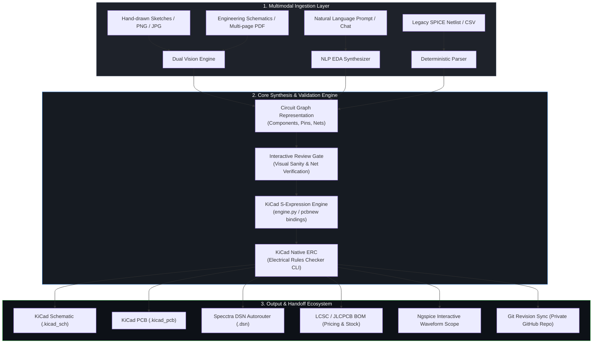

<div align="center">

# DeCad
### The "Cursor for Hardware" &middot; AI-Native Circuit IDE &middot; Specctra DSN Routing Engine

[](https://www.kicad.org/)
[](https://www.docker.com/)
[](https://fastapi.tiangolo.com/)
[](https://nextjs.org/)
[](https://ngspice.sourceforge.io/)
[](LICENSE)

<p align="center">
  <b>DeCad is "Cursor for Circuits" &mdash; an agentic, AI-first Integrated Development Environment for hardware engineering.</b><br/>
  Just as Cursor and Antigravity modernized software development through in-context pair programming and autonomous code synthesis, <b>DeCad brings agentic pair-engineering to physical electronics</b>: synthesizing native KiCad schematics, auto-routing via Specctra DSN, running simulation checks, and sourcing real components in real time.
</p>

---

</div>

## The Paradigm: "Cursor for Circuits"

For decades, software development had modern IDEs with autocomplete, linting, and AI pair-programmers, while **hardware designers remained trapped in manual, point-and-click graphical EDA suites from the 1990s**.

| Software Engineering (Cursor / Antigravity) | Hardware Engineering with **DeCad** |
| :--- | :--- |
| **Natural Language to Code**: Type what you want, AI generates functions | **Natural Language to Schematic**: Type *"Add buck converter with 3.3V out"*, DeCad generates symbols & wiring |
| **Multimodal Inputs**: Screenshot a Figma UI &rarr; React Component | **Multimodal Ingestion**: Photo of a whiteboard sketch &rarr; Native KiCad schematic |
| **Real-time Linting**: Red squiggles on syntax errors | **Real-time ERC**: Live KiCad Electrical Rules Check flags floating pins & shorted rails |
| **Package Managers**: `npm install` or `pip install` | **Automated Component Sourcing**: Auto-maps exact LCSC/JLCPCB part numbers, INR pricing & stock |
| **Compilers & Build Tools**: Webpack, GCC, Vite | **Native EDA Compilers**: KiCad S-Expression synthesis + Specctra DSN autorouter output |
| **Git Version Control**: Clean diffs and GitHub synchronization | **EDA Git Sync**: Semantic commit histories and direct repository synchronization |

---

## Architectural Overview

Traditional circuit engineering suffers from severe fragmentation: schematic capture, netlist generation, simulation, routing, and component procurement occur in disparate, incompatible tools. **DeCad solves this by providing a unified pipeline from initial multimodal concept to DRC-clean PCB fabrication files.**



---

## How Complex EDA Workflows Are Simplified

### 1. Optical Schematic to Clean Netlists (Eliminating OCR Hallucinations)
- **The Challenge**: Standard Computer Vision or Large Multimodal Models (LMMs) hallucinate connections, blend intersecting wires, and misread component subscripts.
- **DeCad's Solution**: A hybrid dual-engine architecture:
  - **Deterministic CPU Tier**: OpenCV morphological contour analysis detects symbol geometry (resistors, caps, diodes, IC packages) while Tesseract OCR isolates reference designators.
  - **Fine-Tuned Qwen2.5-VL LoRA Tier**: A 4-bit LoRA vision-language model trained on audited topological netlist pairs (`training/prepared_amsnet`) for complex multi-gate ICs.
  - **The Circuit Review Gate**: Neural outputs are never written directly to the CAD file. DeCad renders an interactive side-by-side reconciliation dialog (`CircuitReview.js`) allowing engineers to verify physical pin mappings before CAD commit.

### 2. Auto-Bounding & S-Expression Synthesis
- **The Challenge**: Programmatically generated KiCad schematic symbols often drift out of sheet borders or overlap pin coordinates, causing catastrophic ERC failures.
- **DeCad's Solution**: The backend placement algorithm (`engine.py`) automatically maps component bounding boxes across row/column grids bounded to standard A4 sheet dimensions ($X \in [38, 230]\text{ mm}, Y \in [35, 175]\text{ mm}$), wrapping dynamically as part density scales.

### 3. Native Specctra DSN PCB Export (Direct Freerouting Bridge)
- **The Challenge**: Converting schematic nets into physical board autorouting formats usually requires tedious manual footprint assignment, board edge definition, and footprint loading in separate GUI applications.
- **DeCad's Solution**: Uses Debian's native `pcbnew` Python engine (`specctra_worker.py`) directly inside Docker to auto-generate board outlines, assign physical packages from the 37,000+ official KiCad footprint library, establish net topology, and emit standard Specctra `.dsn` files with single-click download.

```mermaid
sequenceDiagram
    autonumber
    participant U as User / Engineer
    participant FE as DeCad Workbench (Next.js)
    participant BE as FastAPI EDA Core
    participant KC as KiCad CLI / pcbnew
    participant DB as Components DB (46k symbols)

    U->>FE: Upload sketch / prompt "Place 74LS240 buffer"
    FE->>BE: POST /projects/{pid}/assistant/chat
    BE->>DB: Query footprint & pinout specification
    DB-->>BE: Package_DIP:DIP-20_W7.62mm + Pin Map
    BE->>KC: Generate S-Expression & Execute ERC
    KC-->>BE: 0 Violations, Netlist Verified
    BE-->>FE: Vector SVG Render + Sourced BOM + DSN Ready
    FE-->>U: Live Schematic Canvas & Downloadable .DSN
```



---

## Key Capabilities & Feature Matrix

| Feature | DeCad Implementation | Industry Standard / Competitors |
| :--- | :--- | :--- |
| **CAD Format** | Native KiCad 9 `.kicad_sch` & `.kicad_pcb` | Proprietary closed formats or lossy SVG |
| **Autorouter Export** | Specctra DSN (`.dsn`) via native `pcbnew` | Requires manual footprint assignment & export |
| **Component Catalog** | Auto-enriched from 46,501 symbols + real LCSC Part IDs | Manual BOM typing and web lookup |
| **Electrical Checking** | Real-time KiCad CLI ERC with violation badge counts | Simple visual display without electrical rule verification |
| **Simulation** | Interactive Ngspice scope (transient analysis) | Separate desktop SPICE installation required |
| **Version Control** | Integrated per-project Git with GitHub OAuth Sync | Manual file duplication / ZIP archives |
| **Theme Engine** | 10 live UI engineering themes (Forge, Monokai, CRT Matrix, etc.) | Fixed single theme |

---

## Workbench Interface Map

```text
+----------------------------------------------------------------------------------------+
|  DeCad WORKBENCH   Test1 / rev 6c9eb70   [Theme: Forge v]   o KiCad ready  o CPU ready  |
+---------------+--------------------------------------------------------+---------------+
|  PROJECTS     |  [Schematic] [Source] [BOM (26)] [Nets] [Checks] [Scope] |  AI ASSISTANT |
|  > Test1      +--------------------------------------------------------+  "Add 10k R1" |
|  > Demo       |                                                        |  [Attachment] |
|               |             KICAD VECTOR SCHEMATIC CANVAS              |               |
|  FILES        |                                                        |  Uploaded:    |
|  * board.sch  |                  [U1: 74LS240 Buffer]                  |  [Image Card] |
|  * board.pcb  |                         |                              |  (Double-click|
|  * board.dsn  |                    (Net: DATA_0)                       |   to zoom)    |
|               |                         |                              |               |
|  LIBRARIES    |                  [R1: 10k Resistor]                    |  [Apply Net]  |
|  * Import Doc |                                                        |               |
+---------------+--------------------------------------------------------+---------------+
```

---

## Quickstart & Installation

### Prerequisites
- [Docker Desktop](https://www.docker.com/) (allocated with at least 4 GB RAM)
- Git command line tools

### Launch in 2 Steps
```bash
# 1. Clone repository
git clone https://github.com/JRK14/DeCad.git
cd DeCad

# 2. Build and launch containers
docker compose up -d --build
```

Access the application in your browser:
- **Workbench Interface**: [http://localhost:3100](http://localhost:3100)
- **FastAPI Core Docs**: [http://localhost:8100/docs](http://localhost:8100/docs)
- **Headless KiCad Virtual Desktop**: [http://localhost:6180](http://localhost:6180)

---

## Directory Structure

```text
DeCad/
├── backend/
│   ├── app/
│   │   ├── main.py            # RESTful API, BOM enrichment, DSN export
│   │   ├── engine.py          # KiCad S-Expression symbol placement & bounds
│   │   ├── specctra.py        # Specctra DSN export orchestrator
│   │   └── specctra_worker.py # pcbnew Python bindings for .dsn export
│   └── workspaces/            # User project files and Git histories
├── frontend/
│   └── app/
│       ├── page.js            # Main EDA workbench application
│       ├── globals.css        # Responsive styling and 10 design themes
│       └── BoardExport.js     # PCB planning and layout configurator
├── checkpoints/
│   └── circuit-lora/adapter/  # Qwen2.5-VL 4-bit LoRA adapter weights
├── training/
│   ├── Train_DeCad_Colab.ipynb  # GPU fine-tuning notebook
│   ├── finetune.py            # CUDA LoRA training pipeline
│   └── evaluate.py            # Test split benchmark evaluator
├── libraries/                 # 46k+ KiCad symbols and SQLite database
├── docker-compose.yml         # Container configuration
└── TEAMMATE_GUIDE.txt         # Teammate onboarding and feature guide
```

---

## License & Attribution

Developed by **Raghav Krishna ([@JRK14](https://github.com/JRK14))**. All rights reserved.
Built on top of KiCad EDA, Ngspice, and Qwen Vision Architecture.
